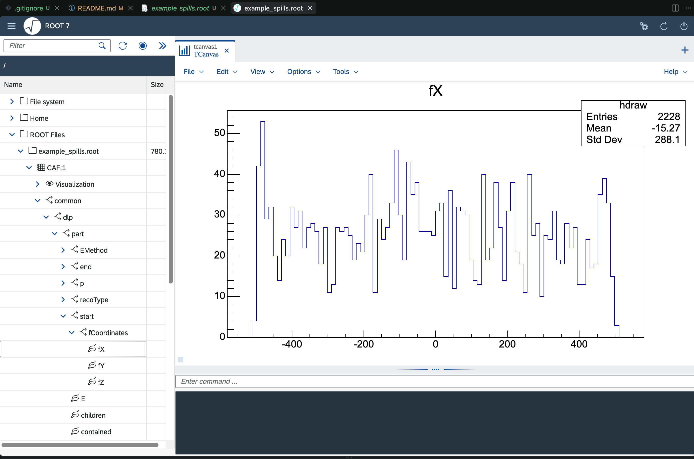

# DUNE_RNTuple

This repository is a playground for an RNTuple replacement for the StandardRecord CAFs. 

You can follow the instructions below or start exploring `example_spills.root`.

## Build

From the repository root:

```bash
cmake -S . -B build
cmake --build build -j
```

## Generate an example RNTuple file

Run the writer executable:

```bash
./build/write_example_rntuple ./build/example_spills.root
```

This writes one RNTuple named `CAF` containing the `common` (reco) and `mc` (truth) fields.

## Plot track lengths and Enu for DLP and Pandora

Run the plotting executable:

```bash
./build/plot_track_lengths \
  ./build/example_spills.root \
  ./build/track_lengths_dlp.png \
  ./build/track_lengths_pandora.png \
  ./build/enu_dlp.png \
  ./build/enu_pandora.png
```

This produces four PNG files:

- `build/track_lengths_dlp.png`
- `build/track_lengths_pandora.png`
- `build/enu_dlp.png`
- `build/enu_pandora.png`

## Plot muon energy resolution

Run:

```bash
./build/plot_muon_energy_resolution \
  ./build/example_spills.root \
  ./build/muon_energy_resolution.png
```

This plots `(E_{reco} - E_{true}) / E_{true}` for muons using truth-matched
reco particles across DLP and Pandora interactions.

## Calculate Enu/containment selection efficiency

Run:

```bash
./build/calculate_selection_efficiency ./build/example_spills.root
```

Selection used per interaction:

- interaction-level `Enu > 2`
- all primary particles are contained

The script prints efficiency summaries for both DLP and Pandora.

## RBrowser

You can explore the RNTuple fills in a TBrowser and it'll look like this.



By the way, there is a RBrowser [extension](https://marketplace.visualstudio.com/items?itemName=CharlotteKnight.root-rbrowser) in vscode that you can try.

## Next plans

Try and do the following things using this RNTuple:

1. Filling a histogram with a particle-level quantity
2. Filling a histogram with an interaction-level quantity
3. Applying a selection and calculating an efficiency
4. Making an energy resolution plot (tests truth matching)
5. Testing schema evolution

Attempting this in a variety of frameworks, with C++ being primary customers, and then Python-based approaches, e.g. uproot.

More ideas are welcome.